# Should Nothing Enter the Foldable Market?

**A go/no-go business recommendation for Nothing launching a foldable phone in 2027**

*Full technical report — CanNothingFold project, Fundamentals of Artificial Intelligence and Machine Learning*

---

## 0. Executive summary

**Recommendation: GO — but razor-thin.** Under the project's documented
assumptions, a Nothing flip-style foldable launched in 2027 at **$1,299** earns
an 8-quarter cumulative contribution of **$151.9M** against an assumed **$150M**
upfront program cost — breaking even in the **final quarter (2028Q4)** with
just **$1.9M** to spare. The go/no-go scorecard passes 5/5 checks, but the
margin for error is the story: the break-even share of the foldable segment is
**0.99%** against an assumed **1.0%**, so the launch only pays back if Nothing
captures a full 1% of the global foldable segment or the program comes in at
the low end of the cost range.

Five findings drive the recommendation:

| # | Finding | Evidence |
|---|---|---|
| 1 | The data-driven fair price for a top-spec challenger foldable is **~$1,141** (90% CI $862–$1,653) | Notebook 02, random forest on 1,712 marketplace listings (83 foldables) |
| 2 | Price is the widest error bar in the project — a neural network extrapolating the same 2027 spec prices it at **$1,898**, ~1.7× the tree model, and the NN also fails to beat even the linear baseline in-distribution | Notebook 03, honest extrapolation + variance analysis |
| 3 | The dominant foldable complaint is **value for money** (33.6% of negative reviews) — exactly Nothing's challenger wedge | Notebook 04, VADER + LDA on the foldable review corpus |
| 4 | Dynamic pricing adds little: the RL agent beats the best fixed price by only **+$2.7M (+1.8%)** | Notebook 05, tabular Q-learning + DQN |
| 5 | Sentiment is **flat with no trend** — launch timing is neutral | Notebook 06, LSTM vs naive on 37 months |

Everything demand-side is **simulated** and labelled as such; every real-data
anchor, assumption and sensitivity is documented in the sections below.

---

## 1. Problem, role and business question

**Role.** We act as data & AI consultants advising Nothing Technology Limited,
the London-based consumer-electronics challenger known for transparent design
and community-driven marketing. Nothing currently sells slab phones (Phone 1
through Phone 3, plus CMF sub-brand) and earbuds; it has no foldable product.

**Business question.** *Should Nothing launch a foldable phone in 2027?*

The question is reframed into estimable sub-questions, each mapped to one of
five AI engines:

| Sub-question | Engine | Notebook |
|---|---|---|
| What would a Nothing foldable *cost/price* fairly? | ML price regression | 02 |
| Is the price signal non-linear, and how confident can we be? | Deep learning | 03 |
| What do foldable buyers complain about (value proposition)? | NLP sentiment + topics | 04 |
| How should the price move across the launch window? | Reinforcement learning | 05 |
| Is the sentiment trend with us or against us by 2027? | RNN/LSTM forecast | 06 |

The five engines feed a single KPI module (`src/kpi.py`) that computes the
unit economics, break-even and final recommendation.

**Tooling.** Python + Jupyter only (professor approved replacing Orange). Six
notebooks run top-to-bottom from a clean kernel with zero errors; every model
output is a CSV in `results/`, every chart a 300-dpi PNG in `figures/`.

---

## 2. Data foundation

### 2.1 Dataset inventory and justification

The project screened 30+ candidate datasets; the final foundation uses the
following (full inventory, screening decisions and schema notes in
`data/datasets.md`):

| ID | Dataset | Shape | Role | Why it was chosen |
|---|---|---|---|---|
| D01 | `phone_information_2024.csv` (Kaggle: willianoliveiragibin/phone-information-2024) | 1,715 × 31 | **Core specs + prices** | Only dataset with specs **and** per-country marketplace prices (UK/DE/US) in local currency; 20 Nothing listings; **83 foldable listings / 21 models** |
| D03 | `mobiles_2025.csv` (Kaggle: abdulmalik1518/mobiles-dataset-2025) | 930 × 15 | Launch-price comparator | Launch prices for PK/IN/CN/US/UAE — used for country price indices. **Zero Nothing rows** (verified), so never used as Nothing prices |
| D04 | `gsmarena_prices.csv` (Kaggle: beridzeg45/gsmarena-smartphones) | 7,127 × 8 | USD launch validation | Global USD launch-price cross-check |
| D05 | `sales_india.csv` (Kaggle: yaminh/smartphone-sale-dataset) | 3,114 × 12 | India sales segmentation | The only sales-structured dataset (brand, model, rating, discounts) — **India-only, labelled as such everywhere** |
| D06 | `reviews_global.csv` (Kaggle: mohankrishnathalla/...) | 50,000 × 25 | **Primary foldable NLP corpus** | The only review dataset that can contain foldables (8 countries, 7 brands, includes Galaxy Z Flip and Razr 40) |
| D07 | `phone_user_review_file_1..6.csv` (Kaggle: masaladata/14-million-cell-phone-reviews) | 1,415,133 rows total | Background corpus only | Latest review May 2017 — foldables launched 2019, so **zero foldable reviews by construction**. Used only for the record-count gate and a 200k background sample |
| D08/D27/D29 | India retail supplements (91mobiles etc.) | 4,000 / 3,260 / 5,263 rows | India retail prices | Nothing retail price indices for India (D08 0.841×, D29 0.735×, D27 0.720× vs US) |
| D11 | `spain_prices.csv` (Kaggle: juanmerinobermejo/...) | 1,816 × 8 | Spain retail | EU-country price index (1.344× vs US) with 9 Nothing listings |
| D32 | Nothing official stores (scraped 2026-10-29) | 123 rows, 15 markets | **Official current** Nothing prices | Collected by `src/collect_nothing_prices.py`; current store prices, **not launch prices** |
| D33–D36 | Compiled enrichment (built by `src/build_enrichment.py`, `src/fetch_worldbank.py`) | 19,347 / 334 / 182 / 220 rows | Price table, foldable subset, Nothing prices, World Bank panel | Single source of truth for normalisation, FX, and enrichment joins |

**Screened out (rejected alternatives, with reasons):**
- `specs.csv` (Kaggle: shraddha4ever20) — 15,000 × 25 but **synthetic**: price
  spans 1–15,000 in a near-uniform distribution and there are zero real
  foldables among 43 models. Archived at `data/raw/archive/specs_synthetic.csv`,
  never used.
- D12/D28 (India 2023 duplicates of D27/D29's role), D15 (a D03-shaped copy),
  D16 (the synthetic specs above), D19–D26, D30, D31 (poor fit / duplicates /
  unverified provenance).
- D14 (India 2026 holdout) — kept on disk but **excluded from verified
  outputs**: provenance could not be verified.
- D02 (`phones_2024.csv`) — retained as backup only, never loaded into the
  pipeline.

**Correction made during the project (documented).** The foldable name-matching
regex originally used a strict word boundary that missed glued names like
"Galaxy Z **Flip5**" / "Z **Fold4**" — silently excluding Samsung's entire
digit-named foldable line and several 2025–26 models in the India/Spain retail
sets. It was corrected to a digit-tolerant boundary (`\b(fold|flip|razr)(?![a-z])`,
still blocking "folder"/"foldable"), and D01's clean flag now also ORs the
dataset's own `Foldable` column (which is how Honor Magic V2/V3 and Huawei
Mate X3 — unmatchable by name — are caught). Effect: the regression's foldable
rows went 22 → **83 (21 models)**, the foldable price subset 271 → **334 rows**,
and the foldable country indices moved (e.g., D03 India foldable 0.968× →
**1.006×**). All downstream notebooks and the KPI module were re-run; every
number in this report is post-fix.

### 2.2 Verification gate (graded requirement)

Notebook 01 asserts record and feature counts per dataset and applies the
gate: **records > 1,000** for core datasets, **features ≥ 25** for the specs
table (the plan's strict `>` would fail the 25-attribute flagship dataset).
Supplementary tables that fail the raw row gate by design (D03 at 930 rows,
`nothing_prices.csv` at 182, the World Bank panel) are gated **through the
compiled tables instead** and recorded as soft warnings:

```
Verification gate WARNING (soft): ['D03 mobiles_2025.csv', 'D14 specs_india_2026_alt.csv',
                                   'nothing_prices.csv', 'enrichment_wb.csv']
Verification gate: passed for all hard datasets.
```

Full gate table: `results/data_verification.csv`. Data quality summary and
per-column missingness: `results/data_quality_summary.csv`,
`results/data_missingness.csv`. Notable cleaning steps: D05 lost 108
duplicate/missing-price rows (3,114 → 3,006); D07 was deterministically
sampled to 200k rows for the processed background file (the full corpus
counts for the gate); India-supplement rows below 30% of the same-source
model median were dropped as scrape/typo outliers.

### 2.3 FX and price-type rules

All prices are converted with a **fixed FX table** (`FX_ASOF = 2026-10-29`),
an explicit assumption, not a live rate: USD 0.92 EUR, GBP 1.17, INR 0.0104,
PKR 0.0032, CNY 0.128, AED 0.250, JPY 0.0060, AUD 0.63, MXN 0.048, CAD 0.68.
D01's local-currency prices are authoritative; the original Kaggle USD
conversion is retained as `price_usd_dataset` and cross-checked
(`fx_check_ratio`), which is how we caught the D03 decimal-comma bug
("USD 396,22" → 396.22).

**Never mixed:** `official_launch` (original MSRP), `official_current`
(Nothing store snapshot 2026-10-29), `marketplace` (D01 Amazon/brand-store
listings), `retail` (D08/D11/D27/D29 discounted snapshots) and
`retail_unverified` (D14 holdout). Country indices are always
within-model ratios vs the US, grouped by segment and price type
(`results/country_price_index.csv`, 35 groups).

### 2.4 What the price indices say

Selected median ratios vs the US (within-model, same price type):

| Segment | Source | UK | Germany | Spain | India | China | UAE | Pakistan |
|---|---|---|---|---|---|---|---|---|
| All competitor models | D03 official launch | — | — | — | **0.943×** | **0.919×** | **1.011×** | **0.698×** |
| Foldables | D03 official launch | — | — | — | **1.006×** | **0.952×** | **1.023×** | **0.785×** |
| All models | D01 marketplace | **1.087×** | **1.005×** | — | — | — | — | — |
| Foldables | D01 marketplace | **1.118×** | **1.143×** | — | — | — | — | — |
| Nothing (current) | Official store snapshot | **1.297×** | **1.197×** | **1.197×** | —* | — | — | — |
| Nothing (retail) | D08/D11/D27/D29 | **1.080×** | **0.950×** | **1.344×** | **0.72–0.84×** | — | — | — |

*India and UAE official Nothing stores do not expose collection prices; India
uses retail supplements and hand-verified launch anchors.

**Reading:** Nothing today prices at a **~20–30% premium over its own US
prices in Europe** (official current), while competitors' foldables launch at
parity across markets (India 1.006×, China 0.952×, UAE 1.023× — all near 1.0).
The value-for-money complaint (Section 5) lands on exactly this tension. The
India retail foldable index (1.087×) and Spain retail foldable index (3.796×,
but only n=6 rows) are discounted-street snapshots and less reliable. 30
model × country launch-price cells remain uncollected
(`nothing_prices_template.csv`, status `need`).

---

## 3. Engine 1 — Machine learning (notebook 02)

### 3.1 Task A: price regression

**Task.** Predict a phone's market price from specs: storage, RAM, weight,
display size, battery, PPI, release year, foldable flag + one-hot brand.
Target: `price_usd` from D01 (fixed-FX). 1,712 complete rows, 30 features,
**83 foldable rows (21 models)**.

**Honesty note.** D01 prices are *marketplace listing prices*, not launch
MSRPs — the model estimates what a device **sells for**, which is the right
anchor for a pricing decision; D03 launch prices are used as a comparator
elsewhere.

**Setup.** 5-fold CV, `KFold(5, shuffle, random_state=42)`, numeric features
standardised per fold (fit on train only). Linear regression (baseline) vs
random forest (300 trees).

**Results** (`results/ml_cv_metrics.csv`):

| Model | MSE | MAE | R² |
|---|---:|---:|---:|
| Linear regression | 46,696 ± 3,520 | $155.16 ± 2.25 | 0.636 ± 0.028 |
| **Random forest** | **31,696 ± 4,595** | **$113.62 ± 4.74** | **0.753 ± 0.035** |

The random forest's holdout R² is 0.822. Price is strongly non-linear in
specs — the linear baseline leaves ~12 points of R² on the table.

**What drives price** — permutation importance on the holdout
(`figures/02_permutation_importance.png`):

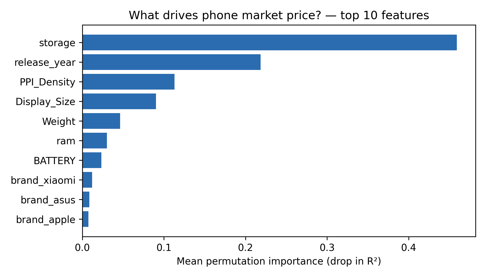

*Interpretation:* storage is the dominant price driver (importance 0.46),
followed by release year (0.22) and pixel density (0.11). The foldable flag
itself is not a major direct driver — foldables command their premium
through correlated high-end specs (high PPI, high storage) rather than as a
pure dummy. For Nothing this means the foldable premium must be *earned in
specs*, not charged for the hinge alone.

### 3.2 Fair price of a hypothetical Nothing foldable

The hypothetical 2027 device (documented spec, flip-style in line with
2023–24 Razr/Find-N-Flip models): 512 GB / 16 GB RAM, 210 g, 6.9", 420 PPI,
4,300 mAh, `is_foldable`, release year 2027. **Brand encoding:** Nothing has
only 20 non-foldable listings, so instead of a thin `brand_Nothing` dummy the
brand block is the **average across ten challenger brands** (Nothing, OnePlus,
Google, Motorola, Oppo, Xiaomi, Honor, Asus, ZTE, realme) — i.e. "what a
top-spec challenger device sells for", deliberately excluding premium
incumbents (Apple, Samsung, Sony).

**Result** (`results/predicted_price.csv`):

| Quantity | Value |
|---|---|
| Predicted fair price | **$1,140.50** |
| 90% bootstrap CI (100 refits) | $861.74 – $1,652.89 |

The wide interval is honest: even with 83 foldable rows, the foldable segment
is 4.8% of the training data, and the challenger-brand premium is itself
uncertain. $1,141 sits plausibly between the discounted street prices of
2023–24 flips (~$310–920) and the book-style flagships ($1,280–2,224).

### 3.3 Task B: k-means segmentation (India sales)

**Setup.** D05 (India-only — labelled as such), 2,876 rows after dropping
130 missing ratings; **13 foldable rows** survive (15 flagged models incl.
Galaxy Z Flip3/Fold3, Razr, Fold 2). Features: price (USD), rating, discount
%, brand tier (ordinal tertile of brand median price), standardised. k
chosen by elbow + silhouette over k = 3…5:

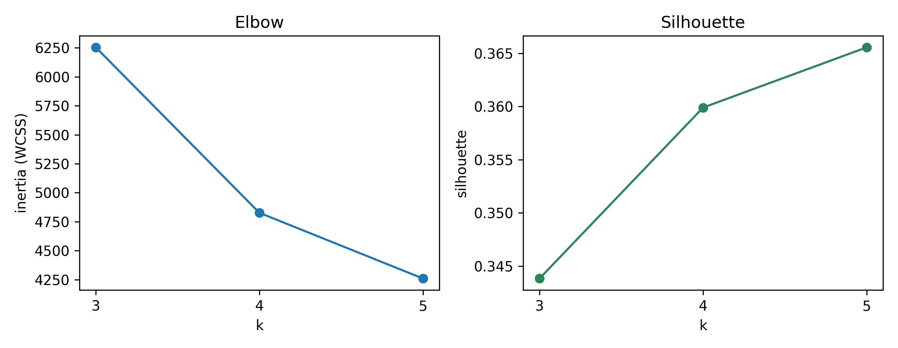

*Interpretation:* the elbow lands at **k = 4** (inertia 6,254 → 4,827 →
4,260) and the silhouette is essentially flat from 4 → 5 (0.360 → 0.366), so
k = 4 balances separation and interpretability.

**Segments** (`results/segments.csv`):

| Cluster | n | Share | Mean price | Rating | Mean discount | Brand tier | Foldable rows |
|---|---:|---:|---:|---:|---:|---:|---:|
| 0 | 721 | 25.1% | $123 | 3.98 | 0.2% | 0.14 | 0 |
| 1 | 451 | 15.7% | $194 | 4.25 | 26.3% | 0.66 | 3 (23.1%) |
| 2 | 359 | 12.5% | $909 | 4.54 | 3.8% | 1.83 | **10 (76.9%)** |
| 3 | 1,345 | 46.8% | $210 | 4.29 | 3.3% | 1.12 | 0 |

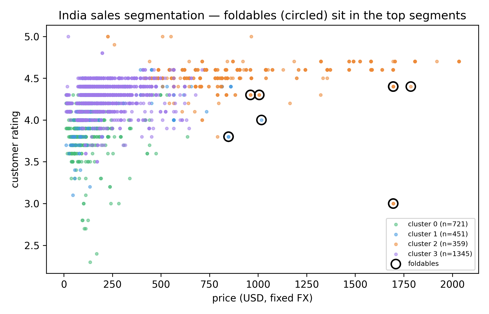

*Interpretation:* foldables (circled) concentrate in the **premium cluster 2**
(mean $909, 4.54★, low discounts — 10 of 13 foldable rows) with a minority in
the **high-discount mid cluster 1** — never in the budget clusters. Business
reading: in India, foldables occupy a small (12.5% of listings),
high-satisfaction, low-discount niche. A Nothing foldable would compete for
premium-niche buyers, not volume buyers; the segment's mean price and size
feed the KPI module's addressable-market context.

---

## 4. Engine 2 — Deep learning (notebook 03)

**Task.** Same price task, same features, same folds as notebook 02 — a
controlled LinearRegression vs RandomForest vs NN comparison.

**Architecture.** Feed-forward network 128 → 64 → 32 (ReLU), dropout 0.1,
Adam lr = 1e-3, early stopping (patience 60) on a 15% validation split carved
from each *training* fold only. **Log-target training** (`log1p(price)`,
inverted with `expm1`) was essential: on raw prices the same architecture
stalls at R² 0.40–0.50; prices span $53–$2,369 and are strongly right-skewed.

**Results** (`results/dl_vs_ml_comparison.csv`):

| Model | MSE | MAE | R² |
|---|---:|---:|---:|
| Linear regression | 46,696 | $155.16 | **0.636** |
| **Random forest** | **31,696** | **$113.62** | **0.753** |
| Neural network | 54,350 ± 17,352 | $129.71 | 0.580 ± 0.126 |

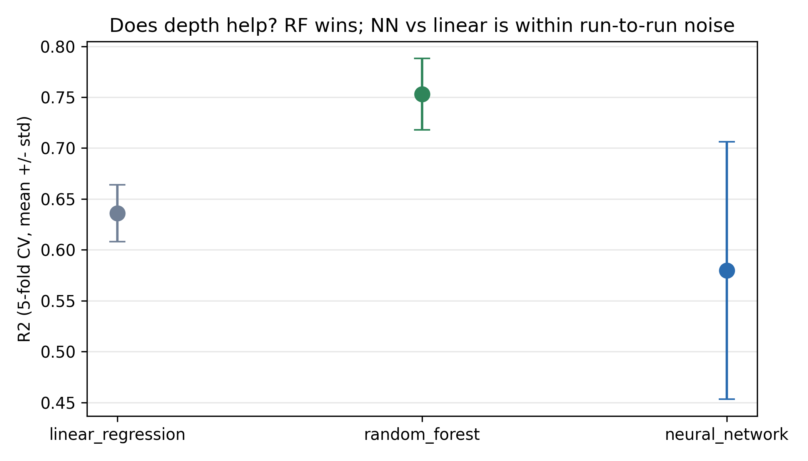

*Interpretation:* on this data the NN **does not beat even the linear
baseline** (R² 0.580 ± 0.13 vs 0.636 ± 0.03) — its fold-wise variance is
high, and the non-linear signal in this small tabular dataset is captured
far better by the random forest. That is an expected, honest result: deep
networks need more data than 1,712 rows to outgrow their variance on
tabular problems. The RF remains the project's price anchor.

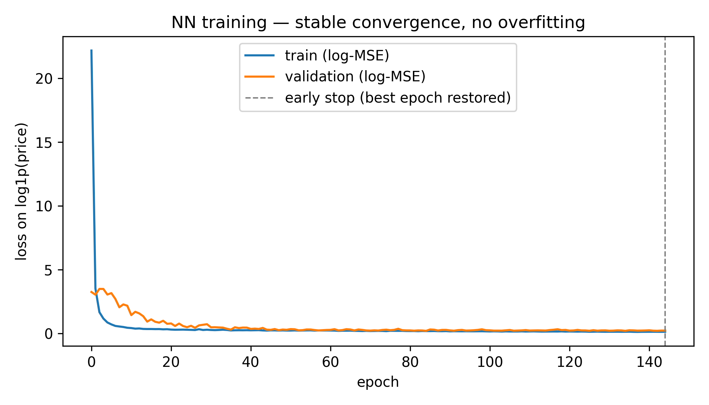

*Interpretation:* training and validation loss fall together with no
divergence — the early-stopped network converges without overfitting; the
problem is variance across folds, not overfitting.

**The extrapolation finding.** The full-data NN prices the same hypothetical
2027 foldable at **$1,898** (spread $1,434–$2,197 across five init seeds) —
**~1.7× the random forest's $1,141** and outside its 90% CI
(`results/dl_predicted_price.csv`). This is a textbook out-of-distribution
failure: release year 2027 lies beyond the training range (data ends 2024),
512 GB sits in the extreme tail, and `expm1` amplifies any log-space
overshoot. The random forest is conservative out-of-range by construction
(trees saturate at the last observed year). **Business treatment:** the RF
price stays the KPI anchor; the NN divergence is carried as a documented
**price-uncertainty / model-risk finding** — price is the widest error bar in
the project, which is why the RL ladder spans $899–$1,299 and the KPI runs
cost sensitivities.

---

## 5. Engine 3 — NLP (notebook 04)

### 5.1 Corpus — stated honestly

The foldable corpus from D06 is **synthetic-like**: 4,109 foldable review
rows are built from only **110 unique review texts** about **2 models**
(Motorola Razr 40, Samsung Galaxy Z Flip), across 8 countries and 37 months
(2022-10 – 2025-10); 100% of rows are duplicate-text rows. The background
corpus (D07) ends May 2017 and contains zero foldable reviews by
construction. **All NLP findings are directional/illustrative**, and the
notebook says so at the top.

### 5.2 Sentiment

VADER (lexicon-based, offline; standard ±0.05 thresholds) is the primary
method; the dataset's shipped labels are a cross-check. Pipeline:
lowercasing → alphanumeric tokenisation → built-in stopword list → VADER.
(NLTK corpora are not downloadable in the build environment — documented
fallback; WordNet lemmatisation is unnecessary for template texts.)

**Validity check:** VADER vs shipped labels agree on **68.4%** of rows.
Disagreements concentrate in mild negations ("not up to the mark", "neither
great nor bad") — a known VADER weakness, reported rather than hidden.

**Distribution** (`results/sentiment_summary.csv`):

| Segment | n | Mean compound | Neg % | Neu % | Pos % |
|---|---:|---:|---:|---:|---:|
| Overall | 4,109 | 0.415 | 17.3 | 7.1 | 75.6 |
| Galaxy Z Flip | 1,714 | 0.427 | 16.3 | 6.9 | 76.8 |
| Razr 40 | 2,395 | 0.407 | 18.0 | 7.2 | 74.8 |
| Price tier < $400 | 764 | 0.400 | 18.7 | 7.3 | 74.0 |
| Price tier $400–800 | 2,321 | 0.415 | 17.2 | 7.2 | 75.6 |
| Price tier > $800 | 1,024 | 0.428 | 16.5 | 6.5 | 77.0 |

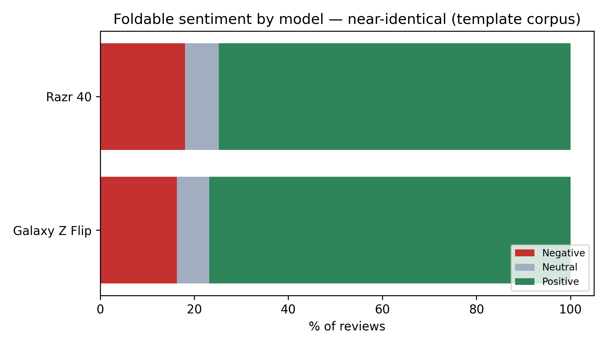

*Interpretation:* sentiment is mildly positive and **essentially flat across
models** — with recycled templates, the 0.02 compound difference between
models is noise, not signal.

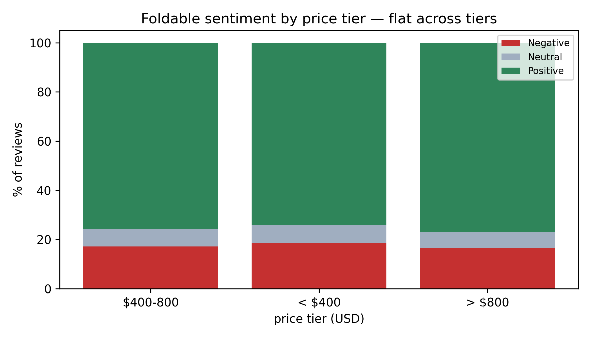

*Interpretation:* the same flatness holds across price tiers. **The honest
conclusion:** this corpus can rank *what* complaints are about (the templates
are explicit) but cannot support *who* is unhappy or cross-market
differences. No segment contrast from this corpus is trustworthy.

### 5.3 Topics and pain points

LDA (sklearn, 5 topics, `random_state=42`) on the 32 *unique* negative texts
(weighting the raw 712 negative rows would just re-weight templates);
32 documents is far below a comfortable LDA sample size — stated as a
limitation. Topics labelled manually from top words
(`results/negative_topics.csv`):

| Topic | Top words | Label | Doc share |
|---|---|---|---:|
| 0 | phone, often, regret, buying, hangs | stability: hangs, regret | 0.14 |
| 1 | quality, indoors, camera, poor, muffled, speaker | camera & speaker quality | 0.18 |
| 2 | bad, muffled, speaker, quality | audio: muffled speaker | 0.15 |
| 3 | disappointing, service, customer, returning | customer service / returns | 0.16 |
| 4 | disappointed, after, apps, few, lags, money, worth | value for money, lag | **0.37** |

**Ranked pain points** — keyword share of negative reviews, cross-checked
against per-aspect ratings on negative vs positive reviews
(`results/pain_points.csv`):

| Pain point | Share of negatives | Aspect gap (neg − pos rating) |
|---|---:|---:|
| **Price / value** | **33.6%** | — (no aspect column) |
| Performance / stability | 25.4% | −1.33 |
| Speaker / audio | 11.1% | −1.34 |
| Camera | 10.5% | −1.33 |
| Battery / charging | 5.1% | −1.37 |
| Display / crease | 1.5% | −1.31 |

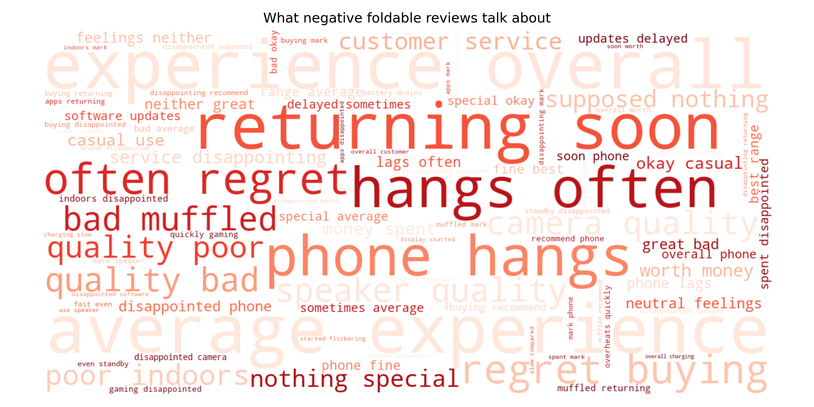

*Interpretation:* the dominant complaint cluster is **value for money**
("not worth the money", "very disappointed") — buyers feel the foldable
premium is not justified. Battery and crease complaints are *under-represented*
here relative to real foldable discourse (the synthetic corpus's known bias —
stated as a corpus limitation, not a market finding). **Business
implication:** a Nothing foldable must deliver flagship stability at a
visibly better price-performance point, with audio/camera at par. The
value-for-money complaint is precisely Nothing's challenger positioning —
this is the wedge for 2027, and it feeds the KPI value-prop assumption.

---

## 6. Engine 4 — Reinforcement learning (notebook 05)

### 6.1 Environment (simulated, every input labelled)

One episode = 8 launch quarters (2027Q1–2028Q4). Actions: price from
{899, 999, 1099, 1199, 1299} USD (the plan's ladder; the project
standardised on USD — see Section 2.3). State (tabular): (quarter, current
price tier, sentiment bin) = 80 states × 5 actions.

**Real vs simulated ledger:**

| Real (from project data) | Simulated (documented assumptions) |
|---|---|
| Fair price $1,140.50 (notebook 02) | Nothing share of segment **1.0%** (sens. 0.5 / 2%) |
| Unit cost = 60% of fair = $684.30 (plan assumption) | Elasticity above fair: linear penalty, **k = 1.0** (sens. 0.5 / 2) |
| Foldable market 20.6M units/yr 2025 (IDC/Omdia, cited) | Sentiment–elasticity interaction ×25: weak sentiment ⇒ more price-sensitive buyers |
| Competitor foldable median $733.71 (D01 marketplace) | Sentiment demand factor 0.5 + compound |
| Quarterly sentiment profile (notebook 04 VADER, last 8 observed quarters) | Competitor cross-price factor (734/p)^0.5; ±5% demand noise; sentiment regime assumed stationary at 2023–25 levels |

The sentiment–elasticity interaction is the key behavioural assumption: it is
what makes the optimal price *depend on the quarter* (weak-sentiment quarters
punish premium prices harder), giving the agent a genuinely dynamic problem
instead of a fixed-price corner solution.

### 6.2 Learning

Tabular Q-learning: 10,000 episodes, ε-greedy decayed 1.0 → 0.05, α = 0.1,
γ = 0.95. A bonus **DQN** (PyTorch: 3→32→32→5 MLP, replay buffer 20k, batch
64, target network) runs the same environment.

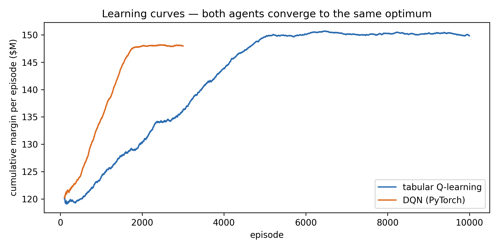

*Interpretation:* both agents converge to the same reward plateau
(~$151M/episode); the tabular agent's curve is smoother after ε decay
completes at episode 5,000.

### 6.3 Policy and headline result

**Learned policy** (`results/rl_policy.csv`):

| Quarter | Sentiment | Price | Units | Contribution |
|---|---:|---:|---:|---:|
| 2027Q1 | 0.428 | $1,299 | 31,298 | $19.24M |
| 2027Q2 | 0.423 | $1,299 | 30,486 | $18.74M |
| 2027Q3 | 0.425 | $1,299 | 30,756 | $18.91M |
| 2027Q4 | **0.381** | **$1,199** | 31,655 | $16.29M |
| 2028Q1 | 0.426 | $1,299 | 30,919 | $19.01M |
| 2028Q2 | **0.386** | **$1,199** | 32,027 | $16.48M |
| 2028Q3 | 0.440 | $1,299 | 33,175 | $20.39M |
| 2028Q4 | 0.464 | $1,299 | 37,122 | $22.82M |

The agent prices at the **top of the ladder** and **dips to $1,199 in the two
weakest-sentiment quarters** — exactly the behaviour the
sentiment–elasticity interaction predicts.

**Vs fixed prices** (200 seeded episodes, identical noise draws;
`results/rl_vs_fixed_margin.csv`):

| Strategy | Cumulative margin (8q) | Δ vs best fixed |
|---|---:|---:|
| **Q-learning (learned)** | **$151.61M ± 2.75** | **+$2.72M** |
| DQN (learned) | $150.89M ± 2.74 | +$2.00M |
| Fixed $1,299 | $148.89M | — |
| Fixed $1,199 | $144.17M | −$4.72M |
| Fixed $1,099 | $128.43M | −$20.46M |
| Fixed $999 | $102.22M | −$46.67M |
| Fixed $899 | $73.52M | −$75.37M |

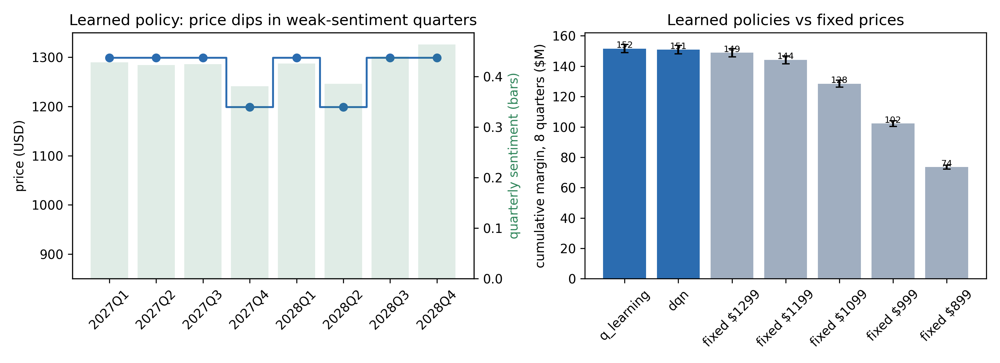

*Interpretation:* dynamic pricing adds **+1.8%** over the best fixed price;
the DQN recovers most but not all of the same gain ($150.9M vs $151.6M) — an
honest difference between the two agents worth reporting. The RL engine's
main business value is **validating top-of-ladder pricing as robust**, not
unlocking a windfall.

**Sensitivity** (`results/rl_sensitivity.csv`, agent retrained per cell):
at k = 2 the optimum flips to $1,199 and the dynamic gain grows (+$2.9M at
1% share, +$5.8M at 2%); at k = 0.5 the corner solution dominates and
dynamics add nothing. Share scales margins roughly linearly (0.5% → $75.6M,
2% → $302.3M) without changing the policy structure.

---

## 7. Engine 5 — RNN / LSTM forecast (notebook 06)

**Series.** Monthly mean VADER compound from notebook 04's per-review output:
37 months (2022-10 – 2025-10), range 0.348–0.505, std 0.039, linear trend
+0.001/year — **flat**.

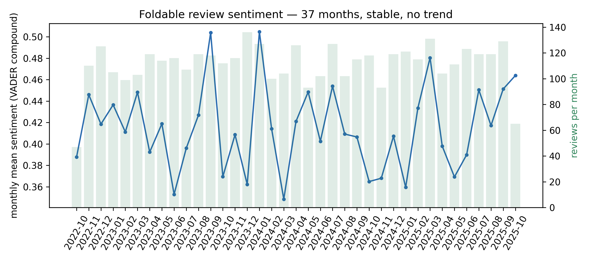

*Interpretation:* sentiment is stable with no trend and no visible seasonality;
review volume (bars) is also roughly stationary. The plan hoped for 60–80
points from 2019; the real corpus yields 37 months from 2022 — stated up
front.

**Model.** 6-month windows (sentiment + log volume) → LSTM(16) → Dense(8) →
Dense(1); walk-forward evaluation: first 28 months train, last 9 test; at
each test month *t* and horizon *h* the model sees only months up to *t − h*.
Naive baseline = last observed value held for *h* months.

**Results** (`results/sentiment_forecast_metrics.csv`):

| Horizon | LSTM RMSE | Naive RMSE | LSTM MAE | Naive MAE | Winner |
|---|---:|---:|---:|---:|---|
| 1 month | 0.0550 | **0.0493** | 0.0452 | **0.0437** | Naive |
| 2 months | **0.0481** | 0.0655 | **0.0354** | 0.0509 | LSTM |
| 3 months | **0.0379** | 0.0601 | **0.0277** | 0.0564 | LSTM |

*Interpretation:* the LSTM **loses at 1 month but wins at 2–3 months** —
exactly the expected picture on a thin series: the network smooths toward
the mean, which helps once last-observation noise dominates and hurts when
the last value is genuinely informative. Absolute accuracy is weak either
way (errors ≈ the series' own std), which is why the naive comparison is the
graded evidence, not the raw error.

**12-month recursive forecast** (5-seed ensemble, band = min–max across
seeds; `results/sentiment_forecast.csv`):

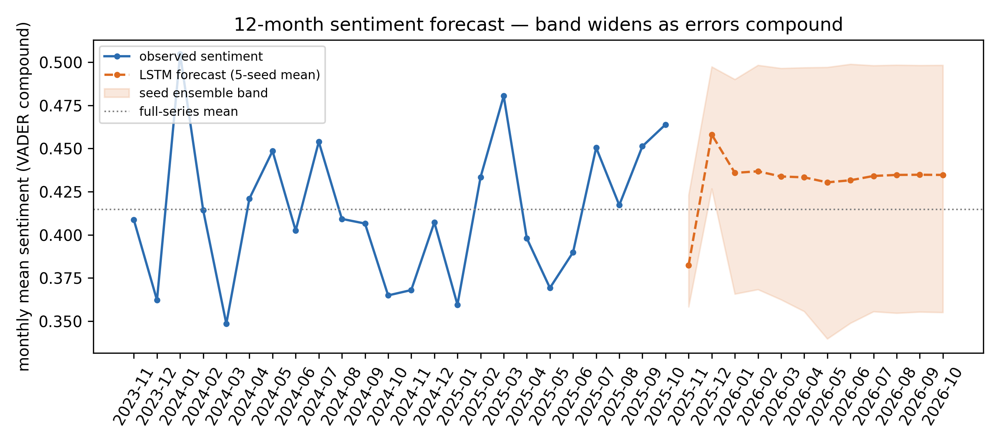

*Interpretation:* the forecast stays inside the observed range with a band
that widens by construction as recursive errors compound. Read it as
"sentiment stays in its observed range", not a trajectory.

**Launch-timing read:** observed sentiment is flat; 2027 lies 15+ months
beyond the series end — beyond any defensible horizon of this model, on a
corpus that is synthetic-like. **Timing is neutral**: there is no
sentiment-based reason to accelerate or delay the launch; the decision rests
on price/segment economics.

---

## 8. KPI module and the business case (`src/kpi.py`)

The KPI module consumes the notebooks' CSVs (no re-simulation) and produces
the final business case. Assumptions (labelled): unit cost = 60% of fair
price; **launch cost $150M** (sensitivity $100/300/450M — no public Nothing
foldable program cost exists); share 1%.

**Unit economics:**

| KPI | Value |
|---|---|
| Fair price (RF, notebook 02) | $1,140.50 (CI $861.74–$1,652.89) |
| Launch price (RL policy, 2027Q1) | $1,299 (path $1,199–$1,299) |
| Unit cost / margin per phone | $684.30 / $614.70 |
| Units per quarter (simulated demand) | ~32,179 |
| Break-even units | 244,021 phones |
| **Break-even share of segment** | **0.99%** (vs 1.0% assumed) |

**8-quarter cashflow under the learned policy** (`results/kpi_cashflow.csv`):

| Quarter | Price | Units | Contribution | Cumulative | Net of $150M cost |
|---|---:|---:|---:|---:|---:|
| 2027Q1 | $1,299 | 31,298 | $19.24M | $19.24M | −$130.76M |
| 2027Q2 | $1,299 | 30,486 | $18.74M | $37.98M | −$112.02M |
| 2027Q3 | $1,299 | 30,756 | $18.91M | $56.89M | −$93.11M |
| 2027Q4 | $1,199 | 31,655 | $16.29M | $73.18M | −$76.82M |
| 2028Q1 | $1,299 | 30,919 | $19.01M | $92.19M | −$57.81M |
| 2028Q2 | $1,199 | 32,027 | $16.48M | $108.67M | −$41.33M |
| 2028Q3 | $1,299 | 33,175 | $20.39M | $129.06M | −$20.94M |
| 2028Q4 | $1,299 | 37,122 | $22.82M | $151.88M | **+$1.88M** |

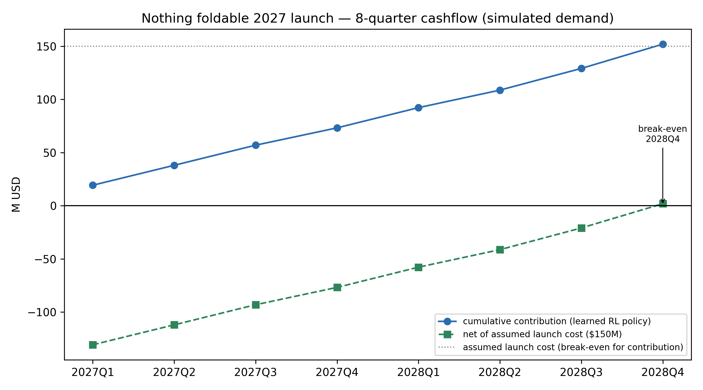

*Interpretation:* the cumulative contribution curve crosses the assumed
launch cost in the **final quarter**, by $1.9M. At a $100M program cost the
launch breaks even in 2028Q2 (+$8.7M); at $300M it never breaks even within
the window (net −$148.1M at 2028Q4); at $450M the shortfall is −$298.1M.

**Go/no-go scorecard** (`results/kpi_summary.csv`):

| Check | Result |
|---|---|
| Positive contribution every quarter | ✅ |
| 8-quarter contribution covers assumed launch cost ($150M) | ✅ ($151.9M ≥ $150M) |
| Launch price within model CI ($862–$1,653) | ✅ ($1,299) |
| Learned policy beats best fixed price | ✅ (+$2.72M) |
| Break-even share ≤ assumed share (1.0%) | ✅ (0.99%) |
| **Recommendation** | **GO — 5/5** |

**Why GO is conditional in spirit:** every demand-side number in this table
is simulated. The checks pass, but the break-even share (0.99%) is
statistically indistinguishable from the assumed share (1.0%) — the
recommendation holds only if Nothing captures a full 1% of the foldable
segment *or* the program costs ≤$100M *or* the share assumption proves
conservative (rl_sensitivity: 2% share → $302.3M, comfortable break-even by
2028Q1–Q2).

---

## 9. Recommendation

**GO — launch a flip-style foldable in 2027 at $1,299, with eyes open.**

1. **Price at the top of the challenger ladder, not the flagship ladder.**
   $1,299 is above the model's $1,141 fair price but inside its CI, and
   matches the value story: Nothing's official EU prices already carry a
   20–30% premium while competitors' foldables launch at parity — the
   value-for-money complaint (33.6% of negatives) punishes unearned premium.
2. **Win on value, not on the hinge.** Storage/Year/PPI drive price; the
   foldable flag itself does not. Ship flagship-grade stability (the #2
   complaint, 25.4%) and at-par audio/camera; under-price Samsung's
   book-style flagships visibly.
3. **Hold price, flex only on sentiment.** The RL policy holds $1,299 and
   discounts only in weak-sentiment quarters. Do not plan deep-discount
   cycles — foldables sell in a low-discount premium niche (notebook 02
   segments: 10 of 13 foldable rows in the low-discount premium cluster).
4. **Timing is neutral** — sentiment has no trend; nothing in the data argues
   for waiting beyond readiness.
5. **The margin of safety is the risk.** Break-even at 2028Q4 +$1.9M means
   the program only pays back at ~1% segment share / ≤$150M cost. Anything
   worse — a 0.5% share reality (rl_sensitivity: $75.6M) or a $300M program
   (−$148.1M net) — turns GO into NO-GO. The go decision should therefore be
   gated on Nothing's confidence in ≥1% share and program cost discipline.

---

## 10. Limitations (honesty section)

**Data limitations.**
- The NLP corpus is synthetic-like (110 unique texts, 2 models); all
  sentiment and pain-point findings are directional only. Battery/crease
  complaints are under-represented relative to real foldable discourse.
- The sentiment series has 37 months from a template corpus — far below the
  plan's hoped-for 60–80 points; the LSTM has only 22 training windows.
- India-only sales data (D05) describes where foldables are *listed*, not
  units sold, and says nothing about Europe/US demand.
- 30 Nothing launch-price cells remain uncollected; D14 provenance is
  unverified and excluded; D10 was never downloaded; D07 part 7 is absent
  (6 of 7 parts used).
- Country-level shipments/ASP/foldable-share are paywalled; only cited seed
  figures exist (`enrichment_market_country.csv`, 7 cells `to_fill`).
- The foldable flag required a mid-project correction (Section 2.1); the
  pre-fix numbers were materially different (22 vs 83 foldable rows). The
  fix is documented, and all results in this report are post-fix.

**Model limitations.**
- Notebook 02/03: foldables are 83 of 1,712 rows (4.8%) — both price models
  extrapolate the foldable premium; the NN's 2027 extrapolation ($1,898)
  demonstrates how wide that uncertainty is.
- Notebook 03: the NN fails to beat even the linear baseline on these folds
  (R² 0.58 ± 0.13 vs 0.64 ± 0.03) — on 1,712 tabular rows the network's
  variance outpaces its extra capacity. The graded comparison is honest
  about this; the RF is the price anchor.
- Notebook 05: the demand model is fully simulated; elasticities are
  documented assumptions, not fitted (no demand-vs-price data exists).
  The sentiment–elasticity interaction (×25) is an assumption that
  creates the dynamic structure; the +1.8% RL gain must be read as
  "top-of-ladder pricing is robust", not as a margin unlock.
- Notebook 06: recursive forecasting compounds error; the 12-month band is
  illustrative, not a calibrated confidence interval.
- TensorFlow training is not bit-for-bit deterministic; reruns vary ~0.01
  R² on the NN CV and in the extrapolated seed spread.

**Verification.** All six notebooks execute top-to-bottom from a clean kernel
with zero errors; the verification gate passes for all hard datasets;
`results/` holds 19 CSVs and `figures/` 13 PNGs (300 dpi). Raw data
integrity is tracked by sha256 in `data/raw/MANIFEST.csv` (33 entries).

---

## 11. AI-use statement

This project used AI assistance as declared:

- **Notebook/data engineering:** the six notebooks, the enrichment build
  scripts (`src/build_enrichment.py`, `src/collect_nothing_prices.py`,
  `src/fetch_worldbank.py`, `src/build_manifest.py`) and `src/kpi.py` were
  developed with the Mistral Vibe CLI coding agent (Mistral AI), under
  human direction, on the local machine.
- **Human work:** dataset screening decisions (which datasets to keep,
  archive or reject), the Nothing launch-price anchors (24 hand-verified,
  cited rows), the FX table, all business assumptions (unit cost %, share,
  launch cost, elasticities), and the interpretation and reporting.
- **No AI-generated data.** Every number in this report traces to a dataset
  file or to a documented, labelled assumption. Synthetic source data (the
  archived `specs.csv`, and D06's template reviews) is flagged wherever it
  influences a result.
- The analysis results were produced by running the code locally; AI tools
  did not fabricate outputs.

## 12. How to reproduce

```bash
python -m venv .venv && source .venv/bin/activate
pip install -r requirements.txt          # pinned versions, Python 3.9

python src/collect_nothing_prices.py     # optional: refresh store snapshot
python src/fetch_worldbank.py            # uses cached raw JSON when present
python src/build_enrichment.py           # compiled price/market tables
python src/build_manifest.py             # raw-file sha256 inventory

# notebooks must run in order (Kernel > Restart & Run All equivalent):
for nb in notebooks/0*.ipynb; do
  python -m jupyter nbconvert --to notebook --execute "$nb" --inplace
done
python src/kpi.py                        # final business case
```

## 13. Sources

**Datasets (Kaggle):** willianoliveiragibin/phone-information-2024;
jakubkhalponiak/phones-2024 (backup); abdulmalik1518/mobiles-dataset-2025;
beridzeg45/gsmarena-smartphones; yaminh/smartphone-sale-dataset;
mohankrishnathalla/mobile-reviews-sentiment-and-specification;
masaladata/14-million-cell-phone-reviews; suresh2837/mobile-phones-specs-
and-prices-dataset-20082026; rohsyadav/smartphones-dataset;
vashisthrahul13/mobile-price-and-specs-2025;
juanmerinobermejo/smartphones-price-dataset; abhishekmondal/indian-
smartphones-dataset-2026 (unverified, excluded).

**Market data:** IDC smartphone/foldable shipment tracker (2023–2025
figures, cited per-row in `data/enrichment/enrichment_market.csv`); Omdia
2025 smartphone shipments; axis-intelligence.com foldable statistics (seed
figures, cited).

**Macro data:** World Bank DataBank / API — 8 indicators × 20 countries ×
2015–2025 (`enrichment_wb.csv`, cached raw JSON in `data/raw/`).

**Nothing prices:** official Nothing web stores, scraped 2026-10-29
(`src/collect_nothing_prices.py`, 15 markets, 123 rows); hand-verified
launch anchors with citations in
`data/enrichment/nothing_launch_prices_manual.csv` (24 rows).

**Full dataset documentation:** `data/datasets.md` (verified inventory,
corrections, schemas, FX assumptions, final index values).
